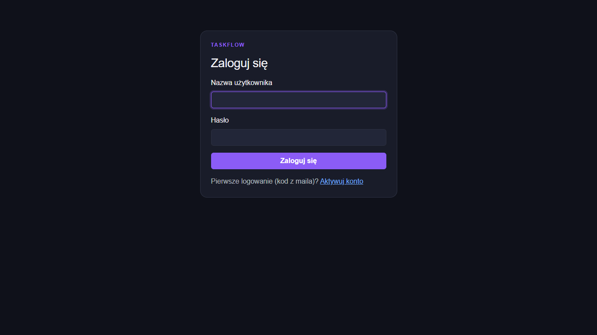
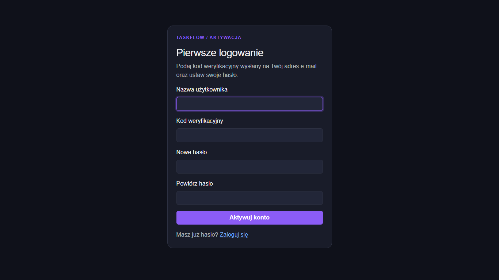
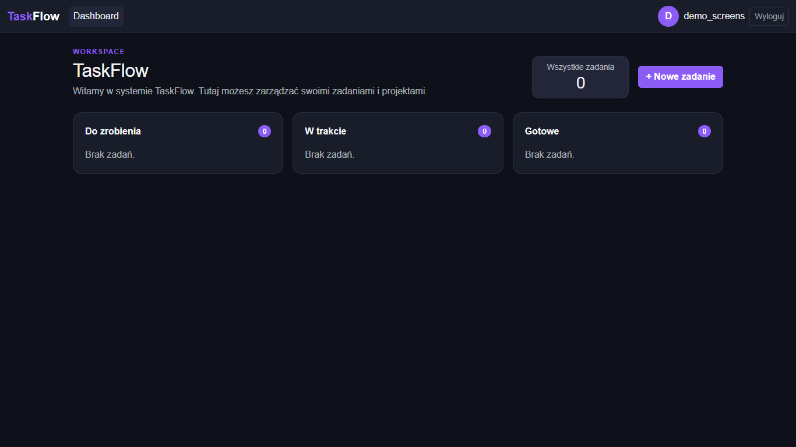
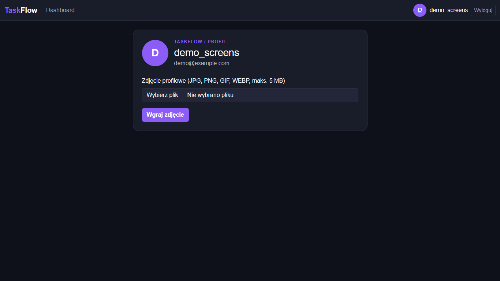
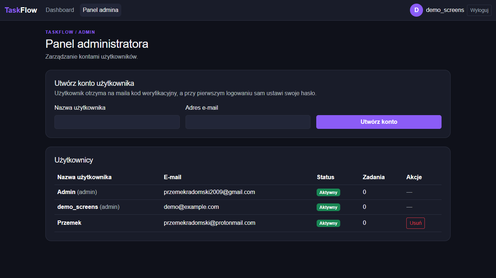

# TaskFlow

Aplikacja webowa do zarządzania zadaniami — backend **Django** (REST API) + frontend **React** (SPA, Vite).

## Zrzuty ekranu

### Strona logowania


### Pierwsze logowanie (aktywacja konta kodem z maila)


### Dashboard — tablica zadań


### Profil użytkownika (wgrywanie zdjęcia profilowego)


### Panel administratora (zarządzanie kontami)


## Funkcje

- **Rejestracja i logowanie** — konto zakłada administrator, a użytkownik je aktywuje
  jednym kodem weryfikacyjnym wysłanym na e-mail (formularz „Pierwsze logowanie").
- **Tablica zadań** — zadania w kolumnach *Do zrobienia / W trakcie / Gotowe*,
  dodawanie i edycja w oknie modalnym.
- **Profil użytkownika** — wgrywanie zdjęcia profilowego (JPG/PNG/GIF/WEBP, maks. 5 MB),
  pliki zapisywane w `media/avatars/`.
- **Panel administratora** — tworzenie kont (z kodem aktywacyjnym na maila),
  przegląd użytkowników i usuwanie kont.
- **Bezpieczeństwo** — CSRF, sesje Django, własny hasher haseł SHA-512
  (`taskFlow/hashers.py`).

## Technologie

| Warstwa | Technologia |
|---|---|
| Backend | Python 3.15, Django 6.1 |
| Baza danych | PostgreSQL |
| Frontend | React 19, React Router 7, Vite 7, Bootstrap 5 |

## Struktura projektu

```
taskflow/
├── config/            # ustawienia Django (settings, urls, wsgi)
├── taskFlow/          # główna aplikacja (modele, widoki, API, szablony)
│   ├── api.py         # endpointy REST dla SPA
│   ├── models.py      # modele (Issue, Profile, AccountVerification)
│   └── templates/     # szablony serwujące SPA
├── frontend/          # kod źródłowy Reacta (strony, komponenty)
├── static/spa/        # zbudowany frontend (wyjście `vite build`)
├── media/             # pliki użytkowników (zdjęcia profilowe)
└── manage.py
```

## Uruchomienie

### 1. Backend

```bash
pip install -r requirements.txt   # Django, psycopg itd.
```

Baza jest skonfigurowana w `config/settings.py` (PostgreSQL, baza `taskFlow`):

```python
DATABASES = {
    'default': {
        'ENGINE': 'django.db.backends.postgresql',
        'NAME': 'taskFlow',
        'USER': 'postgres',
        'PASSWORD': '...',
        'HOST': '127.0.0.1',
        'PORT': '5432',
    }
}
```

Migracje i serwer:

```bash
python manage.py migrate
python manage.py runserver
```

### 2. Frontend

Budowanie SPA (zmiany w `frontend/src` wymagają ponownego builda — Django serwuje
zbudowany kod z `static/spa/`, o czym świadczy manifest `.vite/manifest.json`):

```bash
cd frontend
npm install
npm run build
```

Do pracy na żywo: `npm run dev` (Vite na porcie 5173 z proxy na Django 8000).

### 3. E-maile (tryb dev)

Dopóki `TASKFLOW_EMAIL_USER` i `TASKFLOW_EMAIL_PASSWORD` w `settings.py` są puste,
kody weryfikacyjne **nie są wysyłane mailem** — pojawiają się w konsoli `runserver`.
Aby włączyć realne wysyłanie (Gmail), wpisz adres i tzw. hasło aplikacji
(konto Google → Bezpieczeństwo → Weryfikacja dwuetapowa → Hasła aplikacji).

## API (skrót)

| Endpoint | Metody | Opis |
|---|---|---|
| `/api/auth/login/` | POST | logowanie |
| `/api/auth/first-login/` | POST | aktywacja konta kodem |
| `/api/auth/logout/` | POST | wylogowanie |
| `/api/me/` | GET | dane zalogowanego użytkownika |
| `/api/tasks/` | GET/POST | lista i tworzenie zadań |
| `/api/tasks/<id>/` | GET/PUT/DELETE | szczegóły/edycja/usunięcie zadania |
| `/api/profile/` | POST | wgrywanie zdjęcia profilowego |
| `/api/admin/users/` | GET/POST | zarządzanie kontami (tylko superuser) |
| `/api/admin/users/<id>/` | DELETE | usuwanie konta (tylko superuser) |
